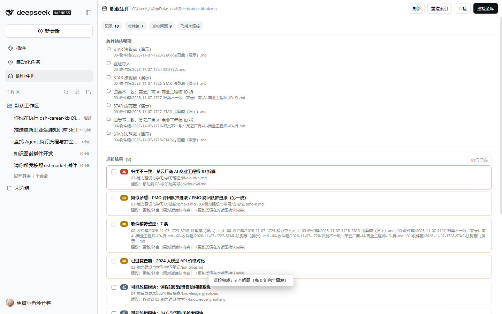

# dsh-career-kb

DeepSeek Harness plugin for a personal career knowledge base: an Obsidian-compatible vault with six career modules, a capture inbox, and ten agent skills — setup, capture, import, full-vault audit, JD-tailored resume, interview prep, interview review, search, JD decode and weekly review.

## Highlights

- **Vault first**: plain Markdown under `%DSH_HOME%/storages/career-kb`, opens in Obsidian.
- **Audit with confirmation**: deterministic scan for duplicates, near-duplicates, redundancy, outdated notes, conflicts, misclassification, missing sources, broken links and orphan notes. Mutations (`career_apply`) require explicit confirmation and are backed up to `_meta/backups/<run>/`.
- **Truthful resume**: evidence matrix built from the vault; no invented roles, dates or numbers.
- **Interview prep / review**: structured templates, mock Q&A, web-search grounded interview reports (when search is available), fact-checked debriefs.
- **Capture from chat**: select text → floating “存入知识库” button, context menu, or assistant bookmark; saved to the inbox and handed to the capture skill.
- **Feishu interop**: reuses the `feishu_*` tools from [dsh-feishu](https://github.com/2048lr/dsh-feishu) when installed (wiki/doc/drive/sheet/bitable) instead of re-implementing them.

## Commands

`/career`, `/career-setup`, `/career-save`, `/career-audit`, `/career-resume`, `/career-prep`, `/career-review`, `/career-search`, `/career-jd`, `/career-weekly`

## Tools

`career_status`, `career_index`, `career_read`, `career_search`, `career_save`, `career_audit`, `career_apply`, `career_verify`, `career_reindex`, `career_skill`



## Install

```sh
dsh plugin --profile <profile> add github:ljttt0824/dsh-career-kb
```

Refresh the page: a “职业生涯” sidebar entry and `/career*` commands appear.

Design: [docs/DESIGN.md](docs/DESIGN.md) (problem framing, layers, audit rules, mutation/backup model, Feishu boundary, cost, limits).

## Verify

```sh
npm test
```

## License

MIT
