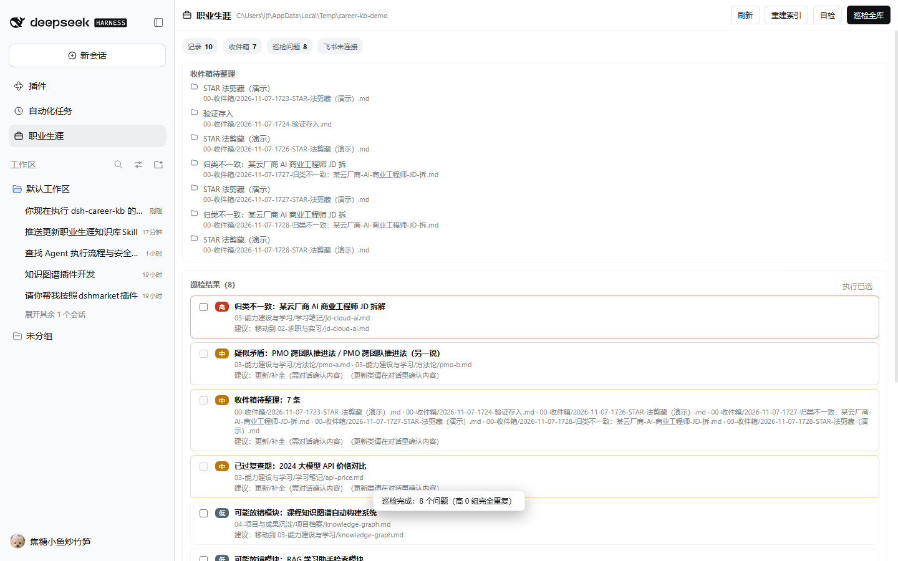
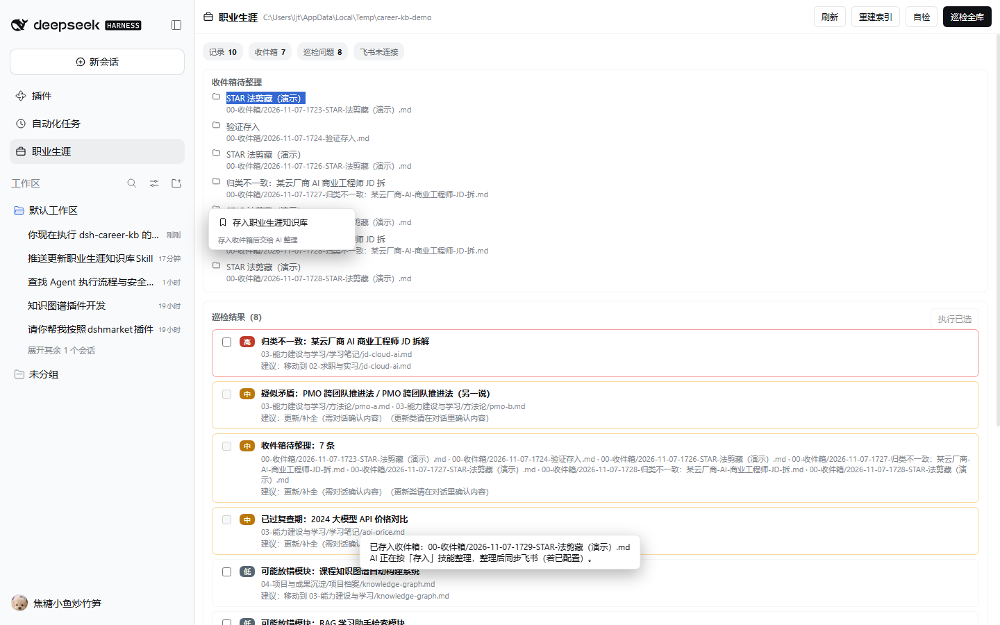

# 职业生涯知识库（dsh-career-kb）

> DeepSeek Harness 插件版：把「智能职业生涯知识库 Skill」升级成一个装进 DSH、能和飞书插件配合使用的职业档案工作台。

它在本机维护一个 Obsidian 可打开的 Markdown 知识库（六大模块 + 收件箱 + 元数据），并用 10 个技能把日常动作串起来：

| 技能 | 斜杠命令 | 做什么 |
| --- | --- | --- |
| 搭建知识库 | `/career-setup` | 访谈式建档：个人画像、职业规划、首页索引 |
| 存入与整理 | `/career-save` | 社媒/网页/截图/选中文字 → 可学习、可复习、可复用的知识卡；查重、分类、同步飞书 |
| 导入已有知识库 | `/career-import` | 把飞书知识库、云文档或本地目录里已有的职业资料按六大模块导入，保留原文与来源 |
| 全库整理巡检 | `/career-audit` | 扫描重复、冗余、过时、冲突、归类错误、无来源、断链、孤立记录；**确认后**才移动/合并/归档/删除 |
| JD 定向简历 | `/career-resume` | 按 JD 检索项目/技能/实习/历史简历，输出证据矩阵 + 不造假的简历 |
| 面试准备 | `/career-prep` | JD + 个人经历 + 联网面经：自我介绍、复习清单、八股/常规/项目深挖/情景题、模拟面试 |
| 面试复盘 | `/career-review` | 真实面试 → 经验沉淀、改进动作、下一轮准备 |
| 知识库检索 | `/career-search` | 带路径与来源的检索问答 |
| JD 拆解 | `/career-jd` | 要求拆解、证据匹配、缺口与投递优先级 |
| 周期复盘 | `/career-weekly` | 周/月复盘，回写规划与投递台账 |

另有 `/career` 列出全部技能。

## 三种调用方式

1. **斜杠命令**：在输入框输入 `/career-audit`、`/career-resume <JD>` 等直接执行，命令不会变成普通聊天消息。
2. **选中文字**：在对话里选中任何一段文字，出现浮动按钮「存入知识库」；右键菜单也有「存入职业生涯知识库」。存入后 AI 会按「存入」技能整理，检测到飞书工具时同步到飞书知识库。
3. **回答书签**：每条 AI 回答下方有书签图标，一键存入整条回答。





## 与飞书插件对接

本插件**不重复实现**飞书能力，而是复用已安装的 [dsh-feishu](https://github.com/2048lr/dsh-feishu) 提供的工具：

- `feishu_wiki` / `feishu_doc`：把职业档案、面试准备、复盘同步成飞书知识库页面或文档；
- `feishu_drive`：上传截图、附件（如简历 PDF）；
- `feishu_bitable` / `feishu_sheet` / `feishu_query`：投递台账、岗位库、面试进度看板；
- `feishu_message`：需要时把提醒/摘要发到飞书。

`career_status` 会探测当前会话是否注册了 `feishu_*` 工具，并在面板显示「飞书已连接 / 未连接」。没有飞书插件时所有功能照常可用，只是成果只写在本机，技能会明确说明「未同步飞书」。

## 数据目录

默认 `%DSH_HOME%/storages/career-kb`（Windows 通常是 `C:\Users\<你>\.dsh\storages\career-kb`），可在 profile 的 `cordis.patch.yml` 里用 `dataDir` 覆盖。

```
career-kb/
  00-收件箱/                  # 选中文字、剪藏、待整理原始资料
  01-职业规划与目标/          # 长期规划、90天行动
  02-求职与实习/              # 岗位库、简历版本、投递台账、面试准备、面试复盘
  03-能力建设与学习/          # 技能树、学习笔记、方法论
  04-项目与成果沉淀/          # 项目档案、实习复盘、作品集
  05-个人背景与经历/          # 个人画像、偏好约束、人脉资源
  06-行业洞察与社会感知/      # 行业观察、赛道分析
  _meta/
    audit/                   # 巡检报告（last.json + report-*.md）
    backups/                 # 每次整理动作的备份
    archive/                 # 归档
    settings.md              # 来源收件箱、飞书同步等设置
  index.md                   # 自动维护的索引
  log.md                     # 操作日志
```

用 Obsidian 直接打开 `career-kb` 目录即可。

## 工具（Agent 侧）

`career_status`、`career_index`、`career_read`、`career_search`、`career_save`、`career_audit`、`career_apply`、`career_verify`、`career_reindex`、`career_skill`。

整理动作的安全约束：

- `career_audit` 只读，返回带 `id` 的问题清单，不修改任何文件；
- `career_apply` 必须 `confirm=true`，执行前自动备份到 `_meta/backups/<run>/`；
- 合并会保留双方标题、来源与日期；删除可恢复（备份 + 日志）；
- 每一步执行后重建索引并写入 `log.md`。

## 安装

DSH 0.2.1+（桌面端或 `dsh web`）任选其一：

```sh
# 从 GitHub 源码安装
dsh plugin --profile <profile> add github:ljttt0824/dsh-career-kb

# 或本地目录
dsh plugin --profile <profile> add /path/to/dsh-career-kb
```

桌面端也可以在 **设置 → 插件** 里添加本仓库。装好后刷新页面：侧边栏出现「职业生涯」入口，输入框 `/` 能看到 `/career*` 命令。

## 自验

```sh
npm test                 # 17 项：core / host / client / feishu 对接
node test/browser-verify.mjs <appUrl> <cdpBase> [panelPng] [capturePng]   # 浏览器端 16 项
```

已在 DSH Desktop 0.2.1-rc.2 上完成：

- 单元 / 集成 17/17 通过；
- 隔离 profile + Edge headless 浏览器端 16/16 通过（面板、巡检、选中文字浮动按钮、右键菜单、存入服务端）；
- 真实 profile 热加载成功（未重启桌面端），`career_status` 识别到 7 个飞书工具，`career_verify` 7 项全绿；
- 空 profile 执行 `dsh plugin add github:ljttt0824/dsh-career-kb` 后启动验证通过（10 个技能、健康检查 ok）。

详细结果与截图见 [docs/VERIFICATION.md](docs/VERIFICATION.md)。

## 隐私

- 知识库只存在本机 `%DSH_HOME%`，不会上传到本仓库或第三方；
- 插件本身不含任何个人数据；`examples/` 与 `templates/` 全部是脱敏虚构示例；
- 只有用户主动调用飞书工具时，内容才会写入用户自己的飞书空间。

## 许可证

MIT
