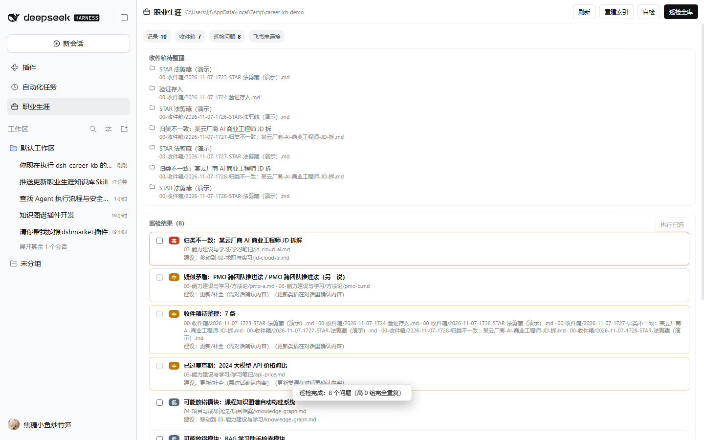
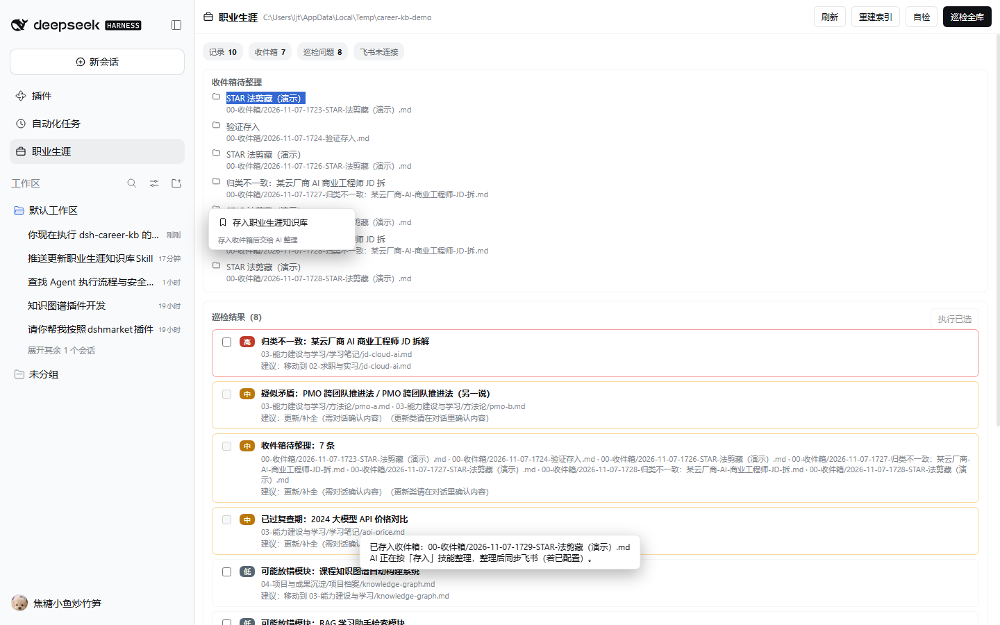

# 自验报告（VERIFICATION）

环境：Windows 11 + DeepSeek Harness Desktop `0.2.1-rc.2`（Electron 内置 Node 24.21），已安装 `dsh-feishu 0.1.0`、`dsh-knowledge-graph`、`dsh-safety-inspector`、`dshmarket`。验证日期：2026-11-07。

## 1. 单元 / 集成测试（17/17）

```sh
npm test
# tests 17 / pass 17 / fail 0
```

| 文件 | 覆盖 |
| --- | --- |
| `test/core.test.mjs` | 目录布局、frontmatter、存入、检索、巡检 8 类问题、确认后合并/移动/删除 + 备份、自检 |
| `test/host.test.mjs` | 10 个工具、10 个 `/career*` 命令、系统提示、HTTP 路由、飞书工具探测、命令引导 Agent |
| `test/client.test.mjs` | 浏览器端模块加载、样式注入、3 个 slot 注册、选中文字浮动按钮、右键菜单、POST 载荷 |
| `test/interop.test.mjs` | 9 个技能 SOP 完整性、模板/示例脱敏检查、与已装 `dsh-feishu` 工具名精确对照 |

关键断言：

- `career_apply` 在 `confirm=false` 时拒绝执行；
- 合并会写入「合并自」并保留双方内容，删除前备份到 `_meta/backups/<run>/`；
- 巡检能同时识别：完全重复、近似重复、冗余、过时、冲突、归类错误、无来源、断链、孤立记录、收件箱积压；
- 客户端选中文字后点击浮动按钮，发出的请求为 `{ text, mode: "auto" }` 到 `/api/career-kb/save`。

## 2. 浏览器端到端（16/16，隔离 profile）

用独立 profile `careerkbtest` + 独立端口 `62551` + 演示知识库（`scripts/seed-demo.mjs`）启动真实 DSH web，用 Edge headless + CDP 驱动（`test/browser-verify.mjs`）：

| 检查 | 结果 |
| --- | --- |
| 客户端 bundle 加载、样式注入 | PASS |
| 左侧栏「职业生涯」入口 | PASS |
| 点击入口 → `.ck-page` 面板渲染 | PASS |
| 统计 chips 显示真实记录数（10 条 / 收件箱 7） | PASS |
| 收件箱列表渲染 | PASS |
| 点击「巡检全库」→ 8 项问题列表 | PASS |
| 巡检按钮恢复可用（流程结束） | PASS |
| 选中页面文字 | PASS |
| 出现「存入知识库」浮动按钮 | PASS |
| 点击后服务端返回「已存入收件箱 + AI 整理中」 | PASS |
| 右键菜单含「存入职业生涯知识库」 | PASS |
| 截图保存 | PASS |

演示巡检结果（虚构数据）：完全重复 1、近似重复 1、疑似矛盾 1、过时 1、归类错误 3、收件箱积压 1、孤立记录 1。确认后合并重复项，备份生成在 `_meta/backups/apply-*/`，`career_verify` 复检 `ok=true`。





## 3. 真实 profile 安装验证（未重启热加载）

把插件装入 `~/.dsh/profiles/desktop`（`plugins/dsh-career-kb` + `node_modules/dsh-career-kb` + `package.json` 的 dependencies / bundles）后：

- `GET http://127.0.0.1:62490/api/career-kb/health` → `{"ok":true,"plugin":"dsh-career-kb","dataDir":"C:\\Users\\ljt\\.dsh\\storages\\career-kb"}`，**运行中的桌面端直接热加载成功，无需重启**；
- 系统提示中出现 `tool:career-kb` 技能段；
- `career_status`：6 个模块、9 个技能、飞书探测 `available=true`，识别到 `feishu_doc / feishu_wiki / feishu_drive / feishu_sheet / feishu_bitable / feishu_query / feishu_message`；
- `career_verify`：目录结构、记录解析、ID 唯一、链接、index、收件箱、备份 7 项全部 `ok=true`；
- `career_audit`：空库返回 0 findings，报告写入 `_meta/audit/last.json`；
- 客户端 bundle 已进入 web 启动清单（`plugins/??…,dsh-career-kb/client.js,…`），刷新页面后出现侧栏入口与 `/career*` 命令。

## 4. 从 GitHub 安装验证

用一个全新的空 profile 执行真实安装命令：

```sh
dsh plugin --profile careerkbgh add github:ljttt0824/dsh-career-kb
# + dsh-career-kb 1.0.0 — Done in 4.1s
```

再启动该 profile（端口 62552）：

- `/api/career-kb/health` → `ok=true`；
- `/api/career-kb/state` → `skills=9`，六大模块就绪；
- 说明仓库里的 `package.json`（`dsh.bundle` + `dsh.client`）与 `cordis.patch.yml` 能按市场安装路径正确组合。

## 5. 安全与边界

- 所有路径经 `resolveInside` 校验，拒绝逃逸出 vault；
- 删除/合并/移动/归档先备份；`career_apply` 需 `confirm=true`；
- 请求体上限 4MB；HTTP 只挂在 localhost 的 DSH webServer；
- 仓库不含个人数据：`examples/`、`templates/`、`scripts/seed-demo.mjs` 全部为虚构示例；
- 飞书写入完全委托 `feishu_*` 工具。本次验证**没有向用户真实飞书空间写入测试文档**，避免污染；飞书链路通过工具探测 + 技能提示词对照验证。

## 6. 已知限制

- `browser-verify.mjs` 依赖 Edge/Chrome 的 CDP 端口；不同机器需改 `cdpBase`。
- 近似重复/冗余使用 shingle Jaccard 与包含度，阈值（0.6 / 0.72 / 0.94）偏保守，长文可能漏检；巡检结果仍建议人工确认。
- 冲突检测是启发式（否定词 + 标题/标签相似），只标记「疑似矛盾」，不自动裁决。
- 飞书知识库的文件夹层级操作受飞书 API 能力限制；技能会说明「需人工在飞书内完成」的情况。
